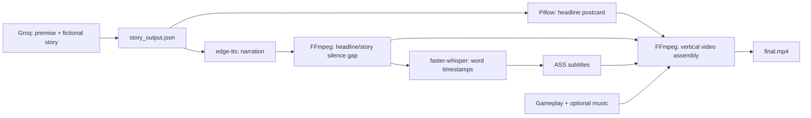
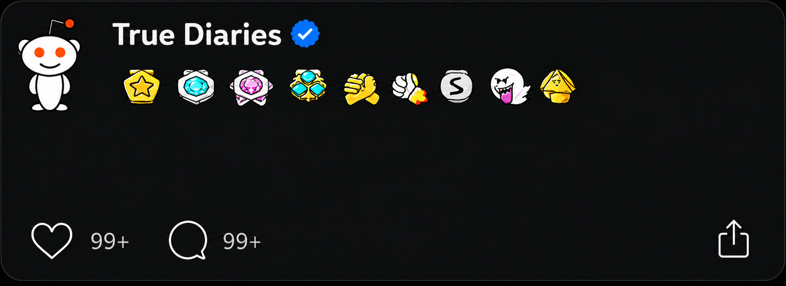

# AI Content Automation Pipeline

**From a fictional story to a captioned vertical video — built with Python and designed for n8n orchestration.**


This project automates the production steps behind short-form storytelling videos: structured script generation, a headline postcard, narrated audio, word-level subtitles, and video composition. Each stage is a standalone Python script with file-based inputs and outputs, making it straightforward to connect the stages in a self-hosted n8n workflow.

**Current release:** the four Python production stages and the postcard template are included. The n8n workflow export is pending. Four sample background videos and four music tracks are included in `assets/`; see the [asset inventory](assets/README.md). YouTube publishing and execution logging belong to the wider automation and are not implemented by these four scripts.

## Pipeline



## What it demonstrates

- **Structured LLM generation:** separate premise and story calls, JSON-schema responses, randomized narrator/category selection, and local validation.
- **Variety controls:** recent premise history and token-based similarity checks reduce repeated setups.
- **Visual automation:** Pillow wraps and sizes a headline over the supplied postcard template.
- **Audio and caption alignment:** narration includes a 0.7-second headline/story gap; Whisper transcribes that same final audio for word-level timestamps.
- **Video composition:** FFmpeg crops footage to 1080 × 1920, overlays the postcard for four seconds, burns subtitles, and optionally mixes quiet background music.
- **Composable automation:** each stage can be invoked from the command line or an n8n Execute Command node.

## Repository layout

```text
.
├── generate_story.py       # Groq premise and story generation
├── postcard_code.py        # Headline image rendering
├── caption_code.py         # Narration and ASS subtitles
├── assemble.py             # Final video composition
├── requirements.txt
├── .env.example            # Configuration names only; no credentials
├── assets/
│   ├── template.png        # Included postcard background
│   ├── gameplay/           # Four sample videos; add your footage here
│   └── music/              # Four sample tracks; music is optional
├── examples/
│   └── story_output.json   # Offline input for a postcard demo
└── workflows/              # Reserved for the sanitized n8n export
```

## Setup

Use Python 3.10 or newer and install **FFmpeg plus ffprobe** on your system PATH. FFmpeg must include the `ass` filter (libass), `libx264`, and an AAC encoder. Install a bold TrueType font such as Arial Bold or DejaVu Sans Bold for the postcard.

```bash
git clone https://github.com/faraz020/End-to-End-AI-Content-Automation-with-n8n-Python.git
cd End-to-End-AI-Content-Automation-with-n8n-Python
python -m venv .venv
```

Activate the environment:

```powershell
# Windows PowerShell
.\.venv\Scripts\Activate.ps1
```

```bash
# macOS / Linux
source .venv/bin/activate
```

```bash
python -m pip install -r requirements.txt
ffmpeg -version
ffprobe -version
```

Copy `.env.example` to `.env` and enter your own Groq key:

```powershell
# Windows PowerShell
Copy-Item .env.example .env
```

```bash
# macOS / Linux
cp .env.example .env
```

`generate_story.py` loads `.env` from the project directory. Existing environment variables take precedence. The default model is `openai/gpt-oss-120b`; change `GROQ_MODEL` if your account requires a different compatible model. The generation requests use JSON-schema structured output and `reasoning_effort`, so a replacement model must support those request parameters.

If automatic font discovery fails, set `POSTCARD_FONT` in your shell to an installed bold `.ttf` font. This setting is read by `postcard_code.py` from the process environment.

Four sample background videos and four music tracks are already included. To use your own media, add `.mp4`, `.mov`, or `.mkv` files to `assets/gameplay/` and optional `.mp3`, `.wav`, or `.m4a` tracks to `assets/music/`. The scripts select a random file from each folder; music is optional. Additional untracked media are ignored by Git by default. To deliberately publish another asset, stage its specific path with `git add -f "assets/gameplay/your-video.mp4"` or the corresponding music path.

## Run the production stages

Run all commands from the repository root. Relative intermediate and media paths are resolved from that working directory.

```bash
python generate_story.py
python postcard_code.py
python caption_code.py
python assemble.py
```

| Stage | Input | Output |
| --- | --- | --- |
| Story generation | Groq key, prompts, recent premise history | `story_output.json`, `recent_premises.json` |
| Postcard rendering | Headline in `story_output.json`, `assets/template.png` | `postcard_final.png` |
| Narration and captions | Headline and story in `story_output.json` | `voiceover.mp3`, `captions.ass` |
| Video assembly | Gameplay, postcard, narration, captions, optional music | `final.mp4` |

Groq and edge-tts require network access. The first faster-whisper run downloads the `small` model; transcription then runs on CPU using int8 computation. Runtime and video duration depend on the story, voice, source media, and machine.

### Try the postcard without an API key

```bash
python postcard_code.py "My Roommate Returned a Package I Never Ordered"
```

The included template is shown below. `postcard_code.py` writes the headline into its central text area.



For a full narration demo without Groq, copy `examples/story_output.json` to the project root as `story_output.json`, then run the remaining three scripts. You still need network access for voice synthesis; the included sample videos can be used for assembly. The example is deliberately short and does not satisfy the production story-length validator.

## Connecting to n8n

The workflow JSON will be added to `workflows/` after it is sanitized. Until then, the commands above document the Python execution order.

### Start n8n locally on Windows

For a local Windows installation, open PowerShell in the repository root, activate the Python environment, and set these variables **before** starting n8n in that same shell:

```powershell
.\.venv\Scripts\Activate.ps1
$env:NODES_EXCLUDE = "[]"
$env:N8N_RESTRICT_FILE_ACCESS_TO = (Get-Location).Path
n8n start
```

`NODES_EXCLUDE = "[]"` clears the node exclusion list, making nodes such as **Execute Command** available. This is the node used to invoke the Python scripts; it is separate from the **Code** node. `N8N_RESTRICT_FILE_ACCESS_TO` allows n8n file operations in the project directory. If your scripts live elsewhere, replace `(Get-Location).Path` with that directory's absolute path. The variables apply to the current PowerShell session and the n8n process launched from it; repeat them when starting from a new shell.

See the official n8n documentation for [node availability](https://docs.n8n.io/hosting/configuration/environment-variables/nodes/) and [file-access configuration](https://docs.n8n.io/hosting/configuration/environment-variables/security/).

In a self-hosted n8n setup with Execute Command available, run the scripts sequentially in the same project working directory. The n8n process or container needs access to Python dependencies, FFmpeg, fonts, media folders, and the Groq key. A Docker deployment must mount the project and its assets into the container; host file paths will not work automatically inside it. Avoid concurrent runs in a shared directory because the current implementation uses fixed intermediate filenames.

## Configuration and current limitations

| Setting | Location | Default |
| --- | --- | --- |
| Groq API key | `GROQ_API_KEY` environment variable / `.env` | Required for story generation |
| Groq model | `GROQ_MODEL` environment variable / `.env` | `openai/gpt-oss-120b` |
| Postcard font | `POSTCARD_FONT` environment variable or `make_postcard(font_path=...)` | Automatically discovered |
| Narration voice / rate | `caption_code.py` | `en-IE-ConnorNeural` / `+44%` |
| Headline/story gap | `caption_code.py` | 0.7 seconds |
| Whisper model | `caption_code.py` | `small`, CPU, int8 |
| Postcard display | `assemble.py` | 4 seconds, 840 px wide |
| Background music volume | `assemble.py` | 0.07 |

Story validation currently checks 220–280 story words, 6–12 headline words, and a list of banned phrases, while the prompts request narrower ranges. There is one story attempt by default. If validation fails, the script logs a warning and returns the last attempt; review generated content before publishing. Premise similarity is a heuristic and does not guarantee originality.

The scripts are a portfolio implementation with fixed filenames and local file handoffs. They do not yet provide isolated per-run directories, provider retries, a queue, or automatic uploads. No API calls or complete video production run are required to inspect the repository.

## Credentials and media

Use your own credentials in environment variables or a local `.env` file. `.env`, generated artifacts, and additional untracked source media are excluded from version control. The eight selected sample media files are tracked. Never commit API keys, OAuth tokens, or n8n credential exports. Rotate any key that was previously exposed.

The supplied template contains third-party branding. Use footage, music, fonts, and artwork you have permission to publish, and replace the template branding when adapting the project for another channel.

## Author

Built by [Faraz Ahmad Siddiqui](https://github.com/faraz020) — AI automation developer working with Python, n8n, LLM integrations, and media workflows.

